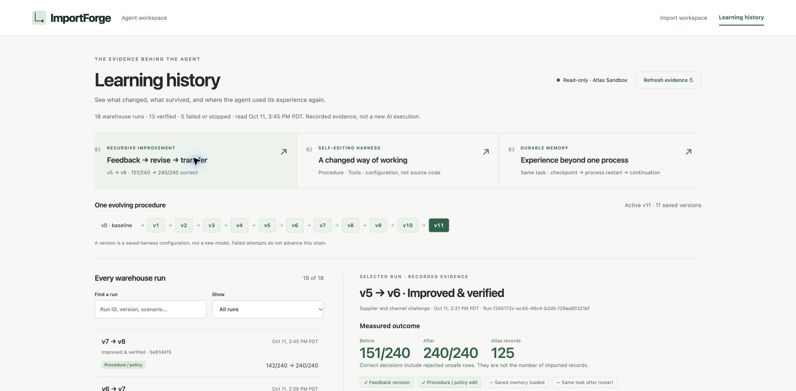
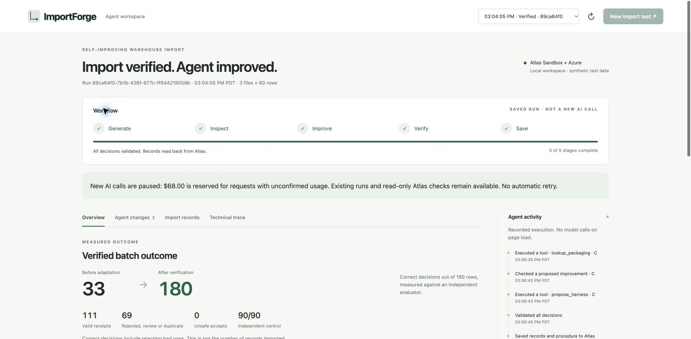

# ImportForge

**A warehouse import agent that improves its own bounded procedure, checks regressions, and remembers what worked in MongoDB Atlas.**

Built for the MongoDB × Cerebral Valley SF Tech Week hackathon on October 11, 2026. Uses the event-provided Atlas Sandbox and Azure-hosted model inference. All trial data is synthetic.

**Public demo:** [Import workspace](https://importforge-demo-894fcf.azurewebsites.net/) · [Learning history](https://importforge-demo-894fcf.azurewebsites.net/history.html). Read-only recorded execution, with live Atlas readback; public AI calls are closed.



## What it does

1. **Generate:** the model designs varied synthetic warehouse formats and faults. Trusted code materializes CSV files and keeps expected answers out of importer tools.
2. **Inspect:** an importer agent investigates a current file with bounded tools and authoritative SKU, packaging and relationship facts.
3. **Improve:** after actual diagnostics, it can propose at most two harness revisions. Revisions can change mappings, JOIN/VALIDATE steps, workflow, tool access and context policies.
4. **Verify:** an independent gate evaluates correct decisions, unsafe accepts and regression controls. A bad candidate is rejected; unchanged or rejected configurations are not called improvements.
5. **Save:** admissible warehouse records and verified harness versions are transactionally saved to Atlas and read back. Later files load saved experience instead of starting from zero.

The main product is the import agent. **Learning history** is its supporting evidence page, not a dashboard substitute.

## Inspect the evidence

Open **Learning history** from the workspace. Three shortcuts lead to recorded evidence, with exact configuration diffs, controls, provenance, Run IDs and Atlas readback:

| Evidence | Recorded result | What it means |
| --- | --- | --- |
| Recursive procedure revision, v5→v6 | A34/60→60/60; the chosen procedure then fails new C at11/60; retained feedback leads to a revised procedure and C60/60. Whole batch151/240→240/240, control90/90, zero regressions. | A second proposal changes the way the task executes after a real failure, not a cached answer selection. |
| Blind transfer | B60/60 and later blind D60/60 without additional importer model calls. | Chosen procedures operate on new rows; row decisions are not cached. |
| New-batch experience reuse, v8 | 320/320 correct, one generator call, zero importer calls, no accepted proposal. | Saved procedures transfer without further adaptation. This is reuse, not another learning cycle. |
| Durable same-task memory, v9→v10 | 33→129 at a safe checkpoint→180/180 after a real Node restart. Same Run ID and matching checkpoint/history hashes, different boot IDs. | Progress, feedback and remaining execution limits survive one process restart. |
| Atlas persistence | Recursive example125/125 stored records matched fresh readback. | Correct decisions and imported record counts are different metrics. |

At publication:18 warehouse runs,13 verified completions,5 failed/stopped runs,11 saved versions plus baselinev0. Failures remain visible. The latest v11 achieved65/90, **not** perfect quality. These are historical observations, not guaranteed results for a new model call.

**Check Atlas now** performs a fresh read-only verification. Browsing history never starts model calls. Saved results are explicitly labelled as recorded execution.



## Honest scope

- The agent edits a constrained harness/configuration. It **does not rewrite application source**, invent executable runtime tools or train model weights.
- The developer supplies trusted synthetic relationship tables, safe JOIN/VALIDATE runtime operations and immutable validators. The agent chooses/revises a bounded procedure using those capabilities.
- A model-generated plan is materialized into files by code; the model does not independently write arbitrary files or bypass the validator.
- Persistent procedure loading is not the same as continuing one unfinished task. Restart evidence covers a safe checkpoint, not an ambiguous in-flight model request, hours of autonomous work or billion-token memory.
- Controls, bounded tasks and synthetic trials are useful evidence, not production accuracy claims.
- A GitHub repository is **not a hosted demo**. The default local operator binds to localhost and rejects other hosts/origins. The deployed Azure viewer is explicitly read-only; public model calls and mutations are blocked server-side.

## Run locally

Requirements:Node.js22.16+ (tested with a runtime that provides `node:sqlite`), npm, your authorized MongoDB Atlas Sandbox access and existing Azure OpenAI-compatible credentials/deployment.

```bash
npm ci
cp .env.example .env
# Fill server-side configuration locally; never commit .env.
npm test
npm start
```

Open http://127.0.0.1:4317/ and http://127.0.0.1:4317/history.html.

Configure `AZURE_OPENAI_ENDPOINT` to your existing Azure `/openai/v1/` endpoint. This hackathon build calls deployment `importforge-astra` through the official OpenAI SDK Responses API. Set `AZURE_KEYS_ROTATED=true` only after confirming the existing credential configuration. No key creation is required by this repository. The public source replaces the developer's resource-specific endpoint with environment configuration; inference logic is otherwise unchanged. The publication snapshot also pins `csv-parse`7.0.3 to address GHSA-8cw4-87c7-c6xx; the isolated51-test suite passes with this version.

Set `MONGODB_URI` and the exact `MONGODB_EXPECTED_HOST` for your authorized Sandbox. With a standard non-SRV URI, use `MONGODB_EXPECTED_HOSTS` as the sorted host:port list. TLS verification stays enabled. The runtime uses database `importforge`; grant only the required scoped database permissions and network access. Existing history is read from Atlas; a new database will not contain the screenshots' runs.

### Spending and execution safety

- The cumulative application cap is$200. SQLite reserves a conservative$34 before every request; confirmed usage settles it. Unknown usage keeps its reservation. This is an application ledger, **not an Azure invoice or subscription-wide spending stop**.
- `state/api-budget.sqlite` is private durable state, excluded from Git. **Do not delete it or start independent copies with the same billing credentials:** separate ledgers would not provide one shared cap.
- The hackathon build stops new model calls after **October11,2026,17:00 America/Los_Angeles**. Historical evidence remains readable. This cutoff is intentional; changing it requires an explicit separate spending decision.
- Maximum7 model requests,12 tool executions and2 proposals per task. No automatic ambiguous-request retry. CSRF, exact host/origin checks and verified Atlas host/TLS are retained.
- Public write/model endpoints are not safe to expose merely by changing the bind address. The authorized Azure viewer uses exact HTTPS-host validation, read-only GET/HEAD enforcement, a bounded read-request rate and a recorded budget snapshot. It receives no Azure model key and cannot reserve spending. A future public operator mode requires separate authentication and a shared durable spend ledger.

## Architecture

```text
Browser workspace / Learning history
             │
Local Node.js + Express API
             ├── Azure model: generation plan + bounded tool-calling importer
             ├── Safe procedure interpreter + immutable domain validators
             ├── Independent candidate / regression / transfer evaluation
             ├── Durable SQLite spending ledger
             └── MongoDB Atlas Sandbox
                 batches · runs · harness versions · receipts · checkpoints
```

Source map:
- `src/warehouse/workflow.js`: agent loop, gates, persistence and read-only evidence API.
- `src/warehouse/model.js`: generator/importer prompts and safe tool schemas.
- `src/warehouse/procedure.js`: bounded JOIN/VALIDATE interpreter.
- `src/warehouse/domain.js`, `evaluator.js`: authoritative warehouse validation and scoring.
- `src/warehouse/checkpoint.js`: safe-checkpoint task continuation.
- `src/warehouse/history.js`: conservative evidence classification/provenance.
- `src/budget.js`: persistent reservation-based cap and cutoff.
- `public/warehouse.*`, `public/history.*`: English workflow and evidence UI.
- `src/harness.js`, `src/evidence.js`: earlier minimal catalog vertical retained as prototype code, not the main demo.

## Verification

51 automated tests cover budget reservations/restarts, domain validation, regressions, bounded procedures, checkpoint identity, memory provenance and evidence classification. UI checked at1710px and390px, with keyboard disclosures and reduced-motion CSS. Before publication, an independent read-only hash comparison confirmed all existing Atlas documents,18 warehouse runs,1315 receipts,activev11 and the spending ledger unchanged; publishing made no model calls.

No credentials, private database exports, runtime ledger, CLI token stores or internal project-management history are included. No hackathon submission is performed by this repository.

## Authorized read-only Azure viewer

The deployment mode `PUBLIC_DEMO_READ_ONLY=true` requires one exact `PUBLIC_ORIGIN` under Azure App Service and a validated `BUDGET_VIEW_JSON` snapshot with its `recordedAt` timestamp. On Azure, startup fails unless read-only mode is explicit. The viewer binds to the platform port; the default local operator remains loopback-only.

Every non-GET/HEAD request is denied before application routes, including generation, resume, continue, cancel, replay and reconcile. The UI closes these actions. Atlas proof, version history, recorded decisions and synthetic CSV downloads remain available. API reads are bounded to120 requests per minute per process. The cloud viewer has no model credential and creates no independent spending ledger. The budget shown is an explicitly dated record from the local operator ledger, not real-time Azure billing.

The live viewer uses one authorized Linux B1 instance with Always On, without autoscaling, custom certificates or new monitoring services. Verified Azure retail price on October11 is$0.017/hour (about$2.85 through October18,2026,15:00PDT, not a billing guarantee). A one-off local Codex automation is scheduled to disable Always On and downgrade this same plan to FreeF1 at that time. Execution requires an available Mac, Codex and valid existing Azure authorization; it is not a platform-enforced spending stop. After that time Atlas access also expires, and Free hosting may cold-start or stop on quota. A separate$10 monthly Azure hosting budget is an alert, not a hard spending stop. The existing model cap$200 is unchanged. Atlas runtime credentials are reused, not regenerated; their authorized expiry is October18,2026,15:00PDT. Network access adds only the current App Service outbound IPs as individual temporary/32 entries. The existing database role is scoped readWrite on `importforge`/Cluster0; this viewer never uses write routes. No public operator authentication or new database user is claimed.

### Portable deployment data

`data/warehouse/` contains the four immutable synthetic reference/regression CSVs required by the runtime and tests. They are loaded relative to this repository, never a sibling workspace. `expected-private-to-evaluator.csv` means synthetic oracle answers are not offered to importer tools; it is not customer data or a secret. Relocating the unchanged files preserves the Atlas reference hash.

Deploy a source ZIP through the official Azure CLI with `SCM_DO_BUILD_DURING_DEPLOYMENT=true` and `ENABLE_ORYX_BUILD=true`. Use standard platform dependency installation and runtime metadata; do not hand-author Oryx internal compression metadata. In this deployment OneDeploy did not reliably install source dependencies, so the verified startup is `npm ci --omit=dev --ignore-scripts && npm start`, with platform port8080. An initial startup can take several minutes; Always On keeps the B1 viewer warm. Never package `.env`, `state`, CLI caches or secrets.
